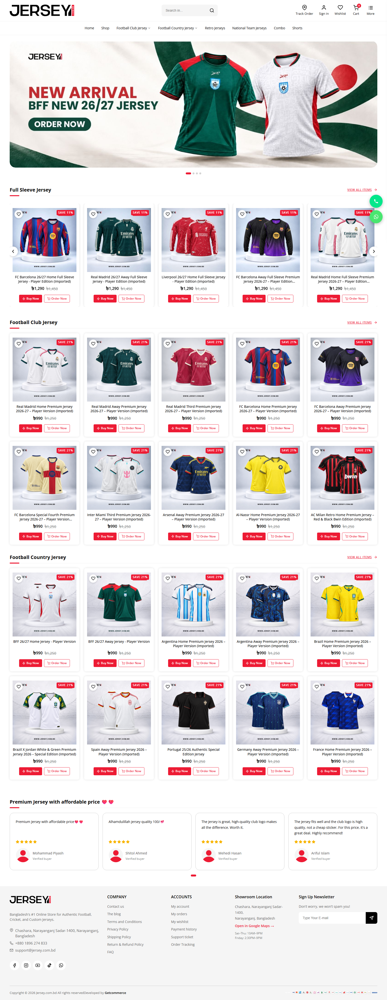

# Jersey.com.bd — Recreation in React + Vite + Node

A faithful, fully functional recreation of **https://jersey.com.bd/** — *“Bangladesh’s #1 Online Store for Authentic Football, Cricket, and Custom Jerseys.”*

Storefront + **real Node backend** + **admin dashboard**: the reference site’s header/search/cart/checkout are rebuilt with live API behavior, and the admin panel can manage orders, products, messages and newsletter subscribers exactly the way a store owner would.

**Deploy to production → [DEPLOYMENT.md](DEPLOYMENT.md)** (Render + GitHub, ~30 min, ~$7/mo for persistent storage)



---

## Quick start

**Prerequisites:** [Node.js](https://nodejs.org/) 18+ (developed on Node 24) and npm.

```bash
npm install        # install dependencies

# --- development (two servers, with hot reload) ---
npm run dev:all    # API on :8787 + Vite dev server on :5173  ← use this
# …or run them separately:  npm run server   (terminal 1)
#                           npm run dev      (terminal 2)

# --- production (single server, one port) ---
npm run build      # build the frontend → dist/
npm start          # serves API + built storefront on http://localhost:8787
```

The storefront works at **http://localhost:5173** (dev) or **http://localhost:8787** (production).
The admin panel is at **/admin** on the same host (e.g. **http://localhost:8787/admin**).

### Admin login

Default development password: **`admin123`** — change it with the `ADMIN_PASSWORD` environment variable (see [.env.example](.env.example)):

```bash
ADMIN_PASSWORD=my-secret-password npm start
```

---

## What’s included

### Storefront
- Header with sticky-on-scroll nav + dropdowns, live product search (desktop + mobile modal)
- Hero carousel (autoplay), Full Sleeve auto-slider, Club & Country product grids
- Full cart flow: drawer, promo progress bar (৳2,000 → FREE delivery), COD / bKash / Nagad
- **Orders are written to the server database** — stock is checked and decremented, delivery computed server-side
- Product detail with size guide, stock indicator, “Only X left” badge, out-of-stock disabling
- Track order by Order ID or phone (works for orders placed from any device)
- Wishlist, demo accounts (device-local), newsletter signup, FAQ, contact form, order history

### Admin dashboard (`/admin`)
| Page | What it does |
|---|---|
| **Dashboard** | Today’s orders/revenue, active/shipped/delivered/cancelled/refunded counts, unread messages, recent orders — auto-refreshes every 30 s |
| **Orders** | **Full order CRUD** — create manual orders (catalog + custom one-off items), edit customer info / delivery address / payment method / note / delivery zone or charge, edit lines (qty, price, name, size, remove), search (id/phone/name/product — tokenized AND search), filter by status with counts, expand to quick view, WhatsApp customer, delete with confirmation |
| | **Order lifecycle** — `pending → confirmed → processing → shipped → delivered` + `cancelled` / `refunded`. Status transitions move stock: cancelling returns all items to inventory, reactivating re-acquires it (validated — no overselling ever), deleting an active order restores stock |
| | **Auto-recalculation** — subtotal, discount (vs. original prices), delivery charge (FREE ≥ ৳2,000, else zone fee or manual override) and grand total recompute on every item/zone change — both live in the editor and authoritatively on the server |
| | **Receipt PDF** — logo header, order/status, customer block, itemised table with discounts, delivery, words-amount, payment method & status — filename `Receipt-<OrderID>.pdf` |
| **Products** | **Full product CRUD** — add new products (name, SKU, category + subcategory, description, regular/sale price, auto-derived sale %, stock, featured flag, active/inactive status, multiple image upload with drag-preview/reorder/remove, variant editor), paginated catalog view (search / category / status filter / 7 sort orders, 12 per page), inline edit everything, delete with confirmation — **orders are never touched** (order items are snapshots). Uploaded images are resized client-side and stored on disk at `server/data/uploads/`, served at `/uploads/` |
| | Storefront reflects all product changes live; new products appear in search/category/shop; featured products get a ⭐ FEATURED badge and sort first |
| **Messages** | Contact-form inbox — read/unread, expand, delete, WhatsApp reply |
| **Newsletter** | Subscriber list + one-click CSV export |

All admin endpoints require a Bearer token issued by `/api/admin/login` (12 h expiry).

---

## Project structure

```
jersey-com-bd/
├── index.html / vite.config.js / package.json
├── public/                  # static assets (76 MB of product/banner photos)
├── docs/screenshot.png
├── server/                  # ── REAL BACKEND ─────────────────────────
│   ├── index.js             # Express 5 API + serves ../dist in production
│   ├── db.js                # JSON-file DB: atomic writes, order validation, stock
│   ├── seed-products.json   # 50 products from the reference catalog
│   └── data/db.json         # created on first boot (gitignored) — orders, messages, subs
└── src/
    ├── data/products.js     # bundled catalog (offline fallback if API is down)
    ├── context/             # Products (API + fallback), Cart, UI, Admin
    ├── components/          # Header, cards, cart drawer, footer, banners…
    ├── pages/               # storefront pages (Home, Shop, Checkout, …)
    │   └── admin/           # AdminLayout/Login/Dashboard/Orders/Products/Messages/Subscribers
    ├── index.css / admin.css
```

## API overview

**Public:** `GET /api/products` · `POST /api/orders` (server-validates phone/items/stock, decrements stock, computes delivery) · `GET /api/orders/track?q=` · `POST /api/messages` · `POST /api/subscribers` · `GET /api/health`

**Admin (Bearer token):** `POST /api/admin/login|logout` · `GET /api/admin/stats` · `POST /api/admin/orders` (manual create) · `GET/PATCH/DELETE /api/admin/orders[/:id]` · `PATCH /api/admin/orders/:id/status` · `POST/PATCH/DELETE /api/admin/orders/:id/items[/:lineId]` · `POST /api/admin/uploads` · `POST /api/admin/products` · `GET/PATCH/DELETE /api/admin/products[/:slug]` (list supports `?search=&category=&status=&sort=&page=&limit=`) · `GET/PATCH/DELETE /api/admin/messages[/:id]` · `GET/DELETE /api/admin/subscribers[/:email]` (+ `.csv`)

## Environment variables
See [.env.example](.env.example) — `PORT`, `ADMIN_PASSWORD` (**required to change for production**), `JBD_DB_PATH`, `JBD_FREE_DELIVERY_THRESHOLD`, and optional `VITE_*` overrides.

## Data & honesty notes

- Orders/messages/subscribers live in **`server/data/db.json`** (a JSON file, atomic writes). Perfect for a small store; swap `server/db.js` for SQLite/Postgres when you outgrow it — the API contract stays the same.
- The frontend gracefully degrades: with no server running, the storefront falls back to the bundled catalog and shows “server offline” toasts. With the server down, checkout saves the order on the device and flags it as offline instead of pretending it reached the store.
- **Payments are manual** — COD, or bKash/Nagad with a Transaction ID the store verifies by hand. There is no payment gateway; never put real credentials here.
- Cart, wishlist and the demo storefront account stay in the browser’s localStorage; real orders and admin actions live in `server/data/db.json`.
- Product images, names, prices, banners and copy reproduced from jersey.com.bd for non-commercial reconstruction.

## Admin data

The current `server/data/db.json` is clean (0 test orders). Place a test order from the storefront to see the dashboard come alive; manage everything at `/admin`.

## Credits
Original design & content: [jersey.com.bd](https://jersey.com.bd/). Built with React 19, Vite 8, Express 5, React Router 7, react-icons. “Developed by Getcommerce” attribution preserved in the footer.
